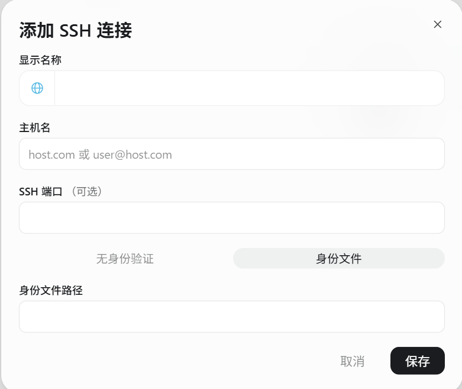

# Codex Desk Tunnel

当前正式版本为 **v0.1.7**。已连接的 Windows 客户端可从左下角检查客户端及服务端更新，服务重启后沿用原来的连接和会话。

Codex CLI 在 Ubuntu VPS 上运行，通过 SSH 读写你选定的 Windows 项目。Windows 主动连接 VPS，项目文件留在本机。普通会话默认建在当前用户的“文档\Codex Desk Tunnel”。“常规”可调整 Codex 审批，“上下文与缓存”可配置空闲压缩，“全局说明”可编辑 VPS 的用户级 AGENTS.md。调用日志按标准短上下文 API 价格估算等价费用，计时取自 VPS 观察到的流式回复。[OpenAI 价格表](https://developers.openai.com/api/docs/pricing)

首次使用先部署 VPS，再安装 Windows 客户端。

## 1. 在 Ubuntu 24.04 VPS 安装服务端

在 Windows 的 CMD 或 PowerShell 里登录 VPS。把 `ubuntu` 和 `VPS_IP` 换成你的用户名和公网 IP。下面的 Linux 命令都在登录后的同一个终端执行。

```console
ssh -t ubuntu@VPS_IP
```

在 VPS 的 SSH 终端粘贴这一行（需要 `curl` 和 root 或 sudo 权限）：

```bash
sudo bash -c "$(curl -fsSL https://raw.githubusercontent.com/zhenxiang-ding/codex-desk-tunnel/main/deploy/install.sh)"
```

脚本会检查依赖；全新 Ubuntu 缺少 Docker 或 Compose 时，按回车同意安装，再按回车启动 Docker。部署向导会显示检测到的 IP；确认它是 Windows 能访问的公网地址，若有误就输入正确的 IP 或域名。其余提示回车即可使用自签证书、TCP **8788**、默认数据目录和随机服务凭据。首次部署会在 VPS 上构建包含 Codex CLI 的镜像。

部署完成后保存**服务地址、证书指纹、服务凭据**，在云安全组和已启用的主机防火墙中放行部署汇总列出的端口。最后一个提示回车开始 Codex 登录，在浏览器完成设备码授权。跳过登录后可在 VPS 运行 `sudo codex-desk-tunnel login`。

[GitHub Releases 下载页](https://github.com/zhenxiang-ding/codex-desk-tunnel/releases/latest) 提供 Windows 桌面安装包、命令行客户端、VPS 服务端包和 SHA-256 校验清单。手工部署时，解压服务端包到独立目录，进入该目录执行 `sudo bash deploy/install.sh`。

## 2. 在 Windows 本机安装客户端

### 用桌面客户端连接

1. 下载并运行 [Codex Desk Tunnel Windows x64 安装包（.exe）](https://github.com/zhenxiang-ding/codex-desk-tunnel/releases/download/v0.1.7/Codex-Desk-Tunnel-Setup-0.1.7-x64.exe)，自带 OpenSSH、PowerShell 和 `cxdt`。
2. 添加服务，粘贴 VPS 显示的服务地址和服务凭据。选了自签证书时，也填入对应的证书指纹。
3. 打开 **设置 → Codex CLI → 账号与额度**。若尚未登录，点 **用设备码登录 Codex**，在本机浏览器打开 OpenAI 授权页，输入桌面端显示的一次性设备码。浏览器确认后，客户端会自动读取 VPS 的账号状态。[OpenAI 无浏览器设备登录说明](https://developers.openai.com/codex/auth/#login-on-headless-devices)
4. 添加 Windows 项目文件夹，创建或选择该项目的会话。在底部输入框直接发送“请通过 SSH 列出当前 Windows 项目的顶层文件，并报告项目路径”。桌面消息列表会显示 Codex 的回复、命令、工具结果和审批请求。关闭窗口后再打开同一会话可查看记录，下一轮继续同一个 Codex 线程。
5. 输入框上方可切换本机项目、查看 Git 分支。点左下角选择审批方式，点右下角模型名调整推理强度或选择 VPS 返回的其他模型。鼠标移到圆环上可查看最近一次 Codex 上报的上下文占用。
6. **设置 → 账号与额度** 提供设备码登录、订阅窗口与重置时间，Plus 账号分别显示 5 小时和每周额度；点击 **调用日志** 可按周期、日期和模型查看桌面对话的 token、缓存命中率和调用明细。**设置 → CLI 设置 → 上下文与记忆** 会自动保存修改。桌面对话默认开启自动记忆，VPS 显式设置优先。此处可调整自动压缩阈值和记忆，其他分组可更改模型、工具行为及权限。需要原生终端时，在会话菜单选择 **打开 Codex 终端** 或 **用 cxdt 打开**。

### 用 CMD 或 PowerShell 连接

Codex 版命令为 `cxdt`，原作者的客户端使用 `ccdt`。两者可以同时安装。已使用旧 Codex 版本的用户请更新安装包，新开终端后用 `cxdt login` 登录一次。桌面安装包已经包含 `cxdt`。安装后新开一个 **CMD**，在你要操作的项目目录里运行：

```bat
cd /d E:\Codex_default
cxdt login
cxdt
```

登录时选刚才保存的 VPS 服务，按提示输入服务凭据。如果从 PowerShell 进入项目，第一行用 `Set-Location E:\Codex_default`。

只用命令行时，从发布页下载 [Windows x64 终端客户端 ZIP](https://github.com/zhenxiang-ding/codex-desk-tunnel/releases/download/v0.1.7/cxdt-0.1.7-windows-x64.zip)，解压后在 `cxdt` 目录打开 PowerShell 并运行：

```powershell
powershell.exe -NoProfile -ExecutionPolicy Bypass -File .\install.ps1
```

新开 CMD，按上面的命令进入项目并执行 `cxdt login`。没有保存过服务时，按提示输入 VPS 显示的连接信息，再运行 `cxdt`。

### 隧道如何通过 SSH 操作 Windows 项目

连接时，Windows 客户端主动连到部署汇总里的 WSS 地址（直连示例 `wss://vps.example.net:8788/ws`），在本机回环地址启动随包的 OpenSSH，并为这次连接生成临时密钥。服务端通过这条隧道把 SSH 命令送回 Windows。Windows 无需开放公网 22 端口，断开后客户端会清理临时密钥。[上游架构说明](docs/architecture.md)

选择本机项目并发送消息或打开 **Codex 终端** 后，服务端会为该会话配置 SSH 别名。`device` 指向当前项目所在电脑，可供 SSH、SCP 和 SFTP 使用；`device-pwsh` 在该电脑运行 PowerShell 脚本。如果 Windows 客户端检测到 Git Bash，还会提供 `device-bash`。要验证连接，可以让 Codex 执行 `ssh device hostname`，把返回值与 Windows CMD 中 `hostname` 的输出对照。这些别名在隧道会话里生效。[会话 SSH 配置](docs/native-runtime.md)

## 在 OpenAI Codex 桌面端添加 SSH 连接（可选）

如果想用 **OpenAI Codex 桌面端打开 VPS 上的项目**，在桌面端进入 **设置 → 连接 → SSH**，打开 **添加 SSH 连接**。这个入口登录 VPS 宿主机。上面一键安装的 Codex CLI 位于 Docker 容器内；桌面端直连宿主机后，看到的是该 SSH 用户可访问的远程目录。要让 VPS 上的 Codex 操作 `E:\Codex_default`，使用上面的 **Codex Desk Tunnel 项目会话** 或 `cxdt` 即可。

<a id="windows-ssh-key"></a>

### 在 Windows 本机生成 VPS 登录密钥

在 PowerShell 中用一个新的文件名创建专用密钥。如果文件已存在，请复用已有密钥或另选名称。私钥留在 Windows，将以下命令显示的**公钥**通过云控制台或已有的 VPS 登录方式加入目标账号的 `~/.ssh/authorized_keys`，保留文件中已有的公钥。

```powershell
$key = Join-Path $env:USERPROFILE '.ssh\codex_vps'
New-Item -ItemType Directory -Force (Split-Path $key) | Out-Null
if (!(Test-Path $key) -and !(Test-Path "$key.pub")) { ssh-keygen -t ed25519 -f $key }
Get-Content "$key.pub"
```

在 VPS 上，用要登录的用户运行以下命令。在编辑器里将上一步显示的整行公钥另起一行粘贴，保存后退出。

~~~bash
mkdir -p ~/.ssh
chmod 700 ~/.ssh
touch ~/.ssh/authorized_keys
chmod 600 ~/.ssh/authorized_keys
nano ~/.ssh/authorized_keys
~~~

回到 Windows PowerShell，替换 SSH 用户、主机和端口；看到 VPS 的主机名即表示公钥登录成功。

~~~powershell
ssh -o IdentitiesOnly=yes -o PasswordAuthentication=no -i $key -p 22 ubuntu@vps.example.net hostname
~~~

可在 Windows 的 `%USERPROFILE%\.ssh\config` 中追加以下配置，替换主机、用户名、端口和密钥路径，然后用 `ssh codex-vps hostname` 验证。在上图选择身份文件时，填与 `IdentityFile` 对应的 Windows 完整路径。

```sshconfig
Host codex-vps
    HostName vps.example.net
    User ubuntu
    Port 22
    IdentityFile ~/.ssh/codex_vps
    IdentitiesOnly yes
```

### 填写桌面端连接信息



| 窗口字段 | 填写示例 |
| --- | --- |
| 显示名称 | `我的 Ubuntu VPS`，方便自己辨认。 |
| 主机名 | `ubuntu@vps.example.net`，换成平时 SSH 登录用的用户名和公网 IP 或域名。这里只填 SSH 主机，`wss://…/ws` 地址用于 Desk Tunnel。 |
| SSH 端口（可选） | 使用默认 SSH 端口时留空或填 `22`。平时用 `ssh -p 2222` 登录就填 `2222`。Desk Tunnel 默认的 `8788` 提供 WSS 服务。 |
| 身份文件 / 身份文件路径 | 选择 **身份文件**，填 Windows 本机用于登录这台 VPS 的**私钥**完整路径，例如 `C:\Users\你的用户名\.ssh\codex_vps`。对应的 `.pub` 公钥应已登记在 VPS 登录账号的 `~/.ssh/authorized_keys` 中。 |

先在 Windows **PowerShell** 用相同的主机名、端口和私钥验证。替换下面的示例值；如果已有能登录 VPS 的密钥，直接使用原路径。

```powershell
ssh -o IdentitiesOnly=yes -i "$env:USERPROFILE\.ssh\codex_vps" -p 22 ubuntu@vps.example.net hostname
```

命令应输出 **VPS 的主机名**。首次连接时，请对照云控制台或管理员提供的 SSH 主机指纹。如果命令提示 `Permission denied (publickey)`，核对用户名、私钥路径和该账号已登记的公钥。Desk Tunnel 部署汇总里的服务凭据和 TLS 证书指纹用于 WSS 连接。

桌面端会通过 SSH 在远程用户的登录 shell 中启动 Codex。请用刚才的 SSH 用户登录 **VPS 宿主机**，运行下面两条检查。若提示找不到命令，先按 [Codex CLI 安装说明](https://developers.openai.com/codex/cli/)为该用户安装 Codex，并确保登录 shell 的 `PATH` 能找到它。若尚未登录，在同一用户下运行 `codex login --device-auth` 完成授权。容器里的 `sudo codex-desk-tunnel login` 只负责隧道会话的账号。[OpenAI 远程 SSH 连接说明](https://learn.chatgpt.com/docs/remote-connections#connect-to-an-ssh-host)

```bash
codex --version
codex login status
```

确认登录状态后，在桌面端点 **保存**，连接主机并选择 VPS 上的项目目录。


## 从源码构建

自行编译时，在 Windows x64 上准备 Git、Node.js 24 和 PowerShell 7，首次获取源码时运行：

```powershell
git clone https://github.com/zhenxiang-ding/codex-desk-tunnel.git
cd codex-desk-tunnel
```

已有本仓库的用户直接进入仓库目录。从该目录运行：

```powershell
npm.cmd ci
npm.cmd run prepare:windows:package
npm.cmd run setup:desktop
npm.cmd run build
npm.cmd run desktop
```

连接 VPS 后，选择本机项目，在会话输入框中直接发送消息。需要生成 Windows 安装包时，在同一仓库运行 `npm.cmd run package:windows`，产物位于 `artifacts/windows/`。

## 日常使用

- **查看服务**：在 VPS 运行 `sudo codex-desk-tunnel status`。需要重新查看客户端连接信息时运行 `sudo codex-desk-tunnel summary`。
- **升级服务端**：已连接时打开 **设置 → 关于与更新 → 检查更新**，发现新版后点 **升级服务端到…**。v0.1.7 客户端可直接连接 v0.1.3 至 v0.1.6 服务，在登录后更新。更早的服务因协议版本拒绝登录时，登录页显示 **升级服务端**。确认后等待服务重启，再使用原连接登录。只有提示需要更新容器镜像时，才需在 VPS 执行第 1 节的一键安装命令。
- **继续对话**：在本机打开原来的 Desk 会话，直接发送下一条消息。
- **遇到 `stdin is not a terminal`**：在 Windows Terminal 或 CMD 中按第 1 节用 `ssh -t` 登录 VPS，再逐条执行交互命令。可先在 VPS 执行 `tty`，确认输出是 `/dev/pts/…` 等终端设备。启动本机 `cxdt` 时也要使用交互终端。

## 致谢与许可

感谢原作者 [sun168567](https://github.com/sun168567) 和 [CC Desk Tunnel](https://github.com/sun168567/cc-desk-tunnel) 的贡献者。本项目基于上游 0.3.20，复用桌面端、设备隧道、SSH 和终端转发，并接入 Codex CLI。项目保留 [Apache-2.0 许可证](LICENSE) 和[原始版权声明](NOTICE)。原版的说明、截图和文档见[上游 README](https://github.com/sun168567/cc-desk-tunnel/blob/v0.3.20/README.md)。
